# 3D Vector Geometry Visualiser & Calculator for Edexcel A Level Further Maths

Points, lines and planes rendered in 3D by a from-scratch WebGL renderer, with exact-precision intersections, distances and angles shown as step-by-step worked solutions.

Originally built as my A-Level Computer Science NEA project. [Read the full write-up (PDF)](docs/NEA-writeup.pdf), covering analysis, design, testing and evaluation.

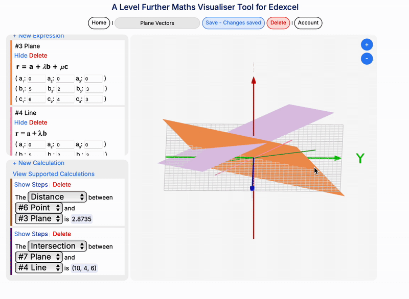

<p>
  <a href="docs/images/alevelcalc-home.png">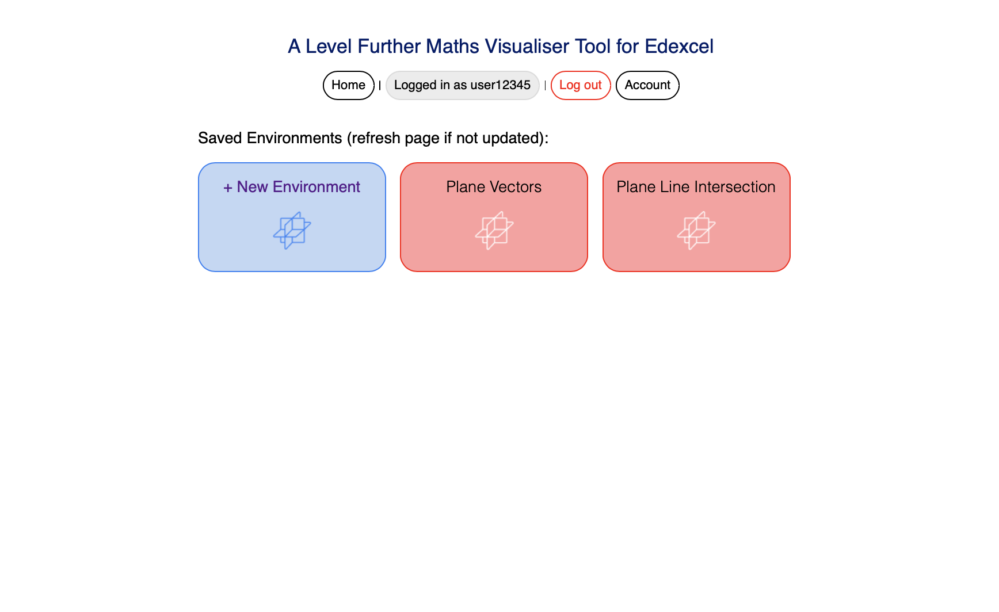</a>
  <a href="docs/images/alevelcalc-new.png">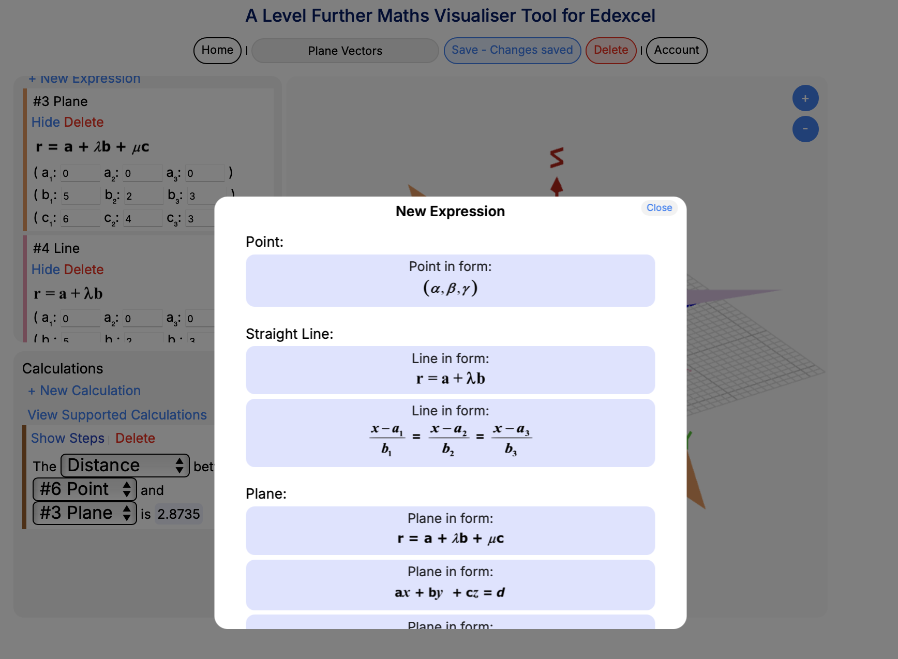</a>
  <a href="docs/images/alevelcalc-calc.png">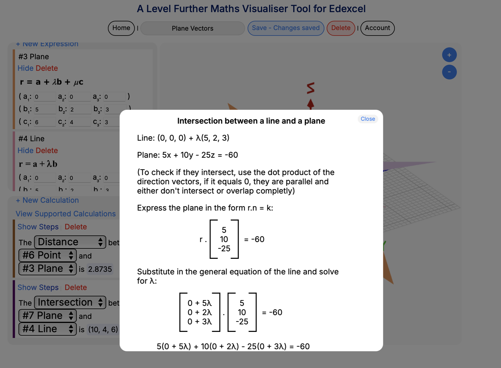</a>
</p>

## Features

- **Objects in specification forms**
  - Points
  - Lines: **r** = **a** + λ**b** and Cartesian (x − a₁)/b₁ = (y − a₂)/b₂ = (z − a₃)/b₃
  - Planes: **r** = **a** + λ**b** + μ**c**, **r**·**n** = k and ax + by + cz = d
- **3D rendering** with a hand-written WebGL renderer and matrix maths (no 3D library), with zoom and rotation
- **Calculations with worked solutions**, shown step by step like a mark scheme:
  - Intersection: two lines (including parallel and skew cases), line and plane
  - Distance: two lines (parallel or skew), point to line, point to plane
  - Angle: two lines, line and plane, two planes
- **Exact arithmetic** using [decimal.js](https://github.com/MikeMcl/decimal.js) to avoid floating-point errors in the worked answers
- **User accounts** with saved environments, autosave and renaming

## Tech stack

- **Backend:** PHP 8 (no framework), mysqli prepared statements
- **Database:** MariaDB / MySQL
- **Frontend:** vanilla JavaScript, WebGL, HTML/CSS
- **Library:** decimal.js (vendored in `lib/`)

## Running locally

Requirements: PHP 8.1+ with the `mysqli` extension, and MariaDB or MySQL.

```sh
# 1. Create the database, an app user, and the demo data
mariadb -u root < database/schema.sql
mariadb -u root < database/create_user.sql    # optional: app user with limited privileges
mariadb -u root < database/seed.sql

# 2. Configure the database connection (optional if the defaults suit you)
cp config.example.php config.php              # then edit, or set DB_SERVERNAME / DB_USERNAME / DB_PASSWORD / DB_NAME

# 3. Start the PHP built-in server from the project root
php -S localhost:8000
```

Then open <http://localhost:8000> and log in with the demo account:

| Username    | Password   |
|-------------|------------|
| `demo_user` | `Demo123!` |

> The app must be served from the web root (e.g. `php -S` as above) rather than a subfolder, as some redirects use root-relative paths.

You could also run the project through the XAMPP environment as I initially did back when I was working on the project.

## Project structure

```
├── index.php            Log in / sign up
├── home.php             List of saved environments
├── 3dview.php           Main 3D editor
├── account.php          Change username / password, delete account
├── error.html           Shown when the database can't be reached
├── config.example.php   Database settings template
├── database/
│   ├── schema.sql       Tables
│   ├── create_user.sql  Optional limited app user
│   └── seed.sql         Demo user and example environments
├── scripts/
│   ├── 3dview.js        Editor UI, calculations and worked solutions
│   ├── expressions.js   Matrix maths and object geometry
│   ├── renderer.js      WebGL renderer
│   ├── renderData.js    Shaders / render data
│   ├── dbConnect.php    Database connection and query helper
│   ├── loginSession.php Login tokens and sessions
│   └── *.php            Form handlers and JSON APIs (login, signup, save, delete…)
├── lib/decimal.js
└── images/
```

## Diagrams (Sample from write-up)

A selection from the [write-up](docs/NEA-writeup.pdf), which has the full set (UI designs, flowcharts, class diagrams, vertex and calculation workings). The project has changed very slightly since the write-up, so a few details may not match the current code.

### How the pages and scripts connect

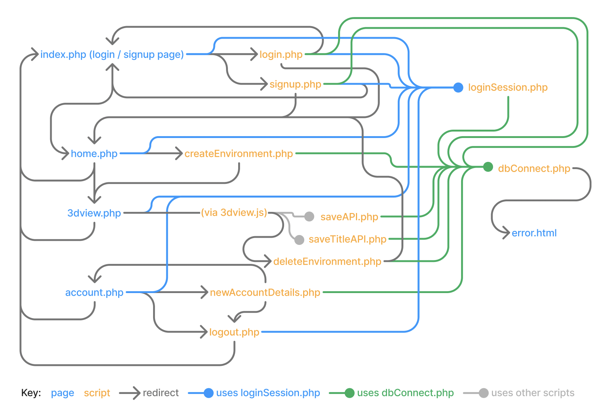

### Database E-R diagram

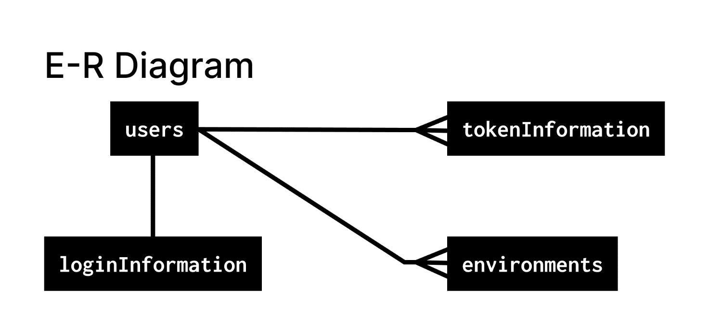

### `expressions.js` class diagram

<details>
<summary>Maths classes: matrix, angle, objectCalculations</summary>

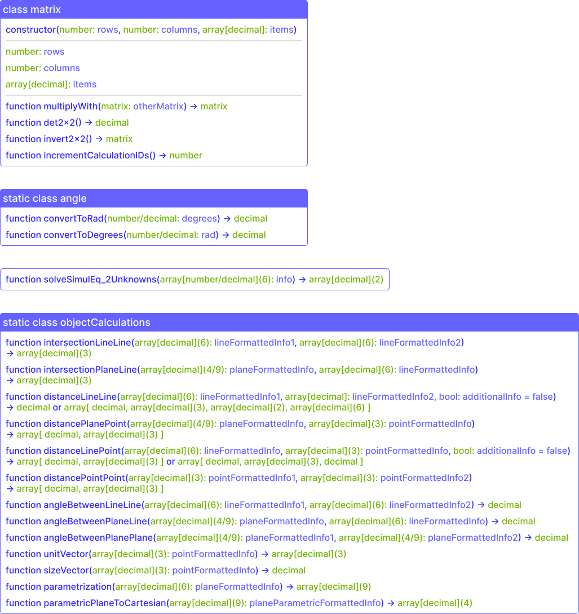
</details>

<details>
<summary>Object classes: expressions, expressionItem, object and its subclasses</summary>

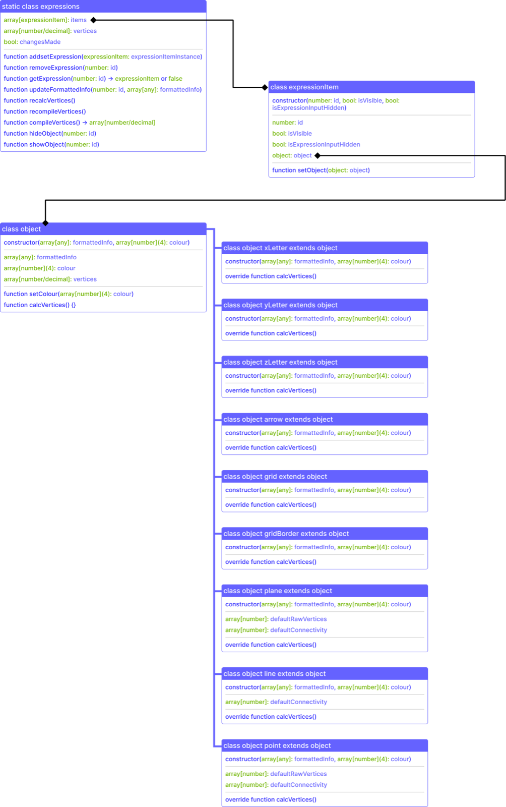
</details>

### Deriving a calculation: distance between two lines

<details>
<summary>Handwritten working</summary>

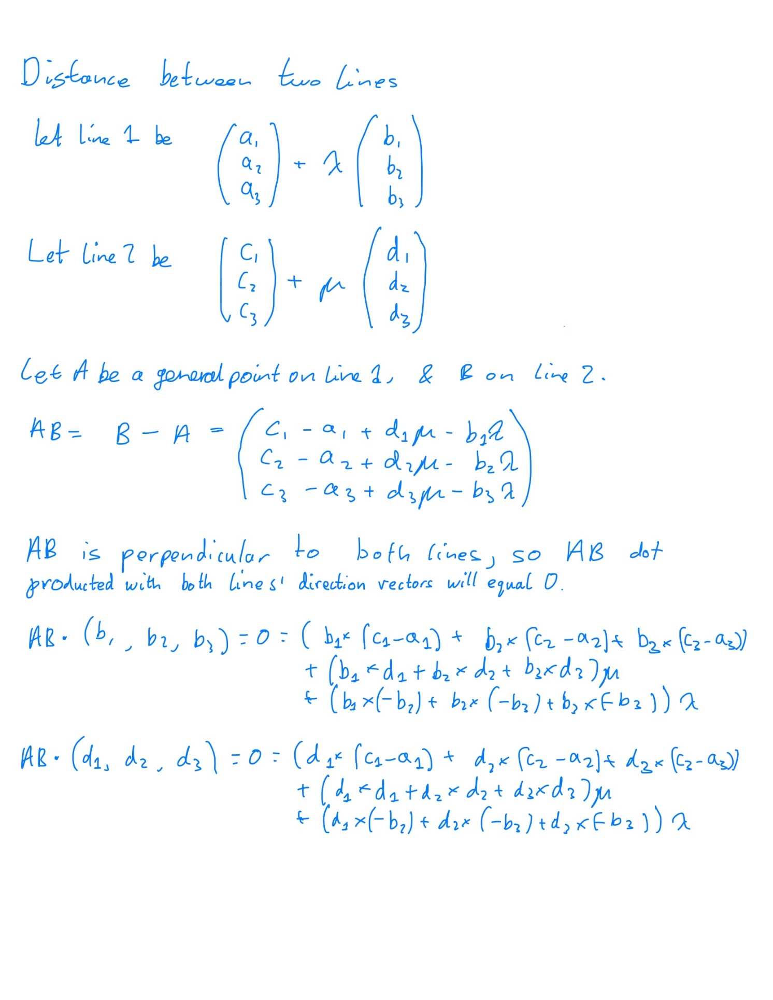
</details>

### Building the 3D objects

<details>
<summary>Vertices and triangles of each object (click an image to enlarge)</summary>

<table>
  <tr>
    <th>Point (cube)</th>
    <th>Line</th>
    <th>Arrow</th>
  </tr>
  <tr>
    <td><a href="docs/images/object-point.png">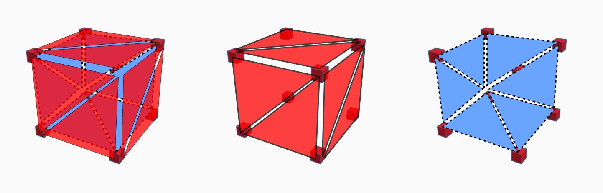</a></td>
    <td><a href="docs/images/object-line.png">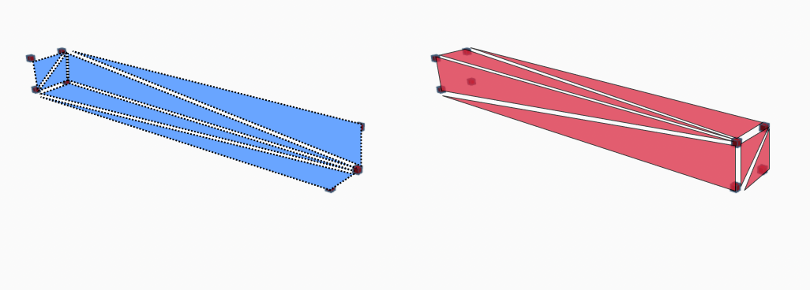</a></td>
    <td><a href="docs/images/object-arrow.png">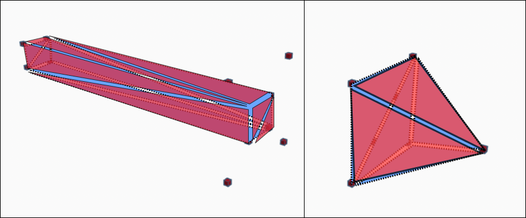</a></td>
  </tr>
  <tr>
    <th>X letter</th>
    <th>Y letter</th>
    <th>Z letter</th>
  </tr>
  <tr>
    <td><a href="docs/images/object-x.png">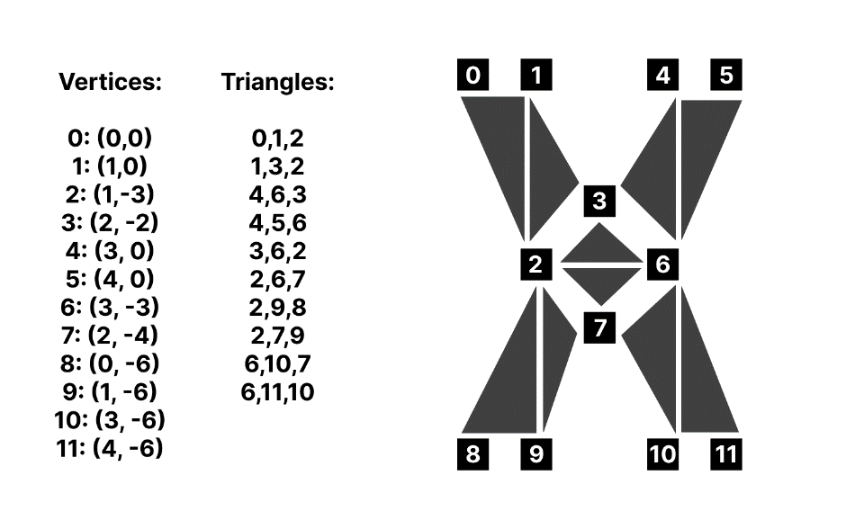</a></td>
    <td><a href="docs/images/object-y.png">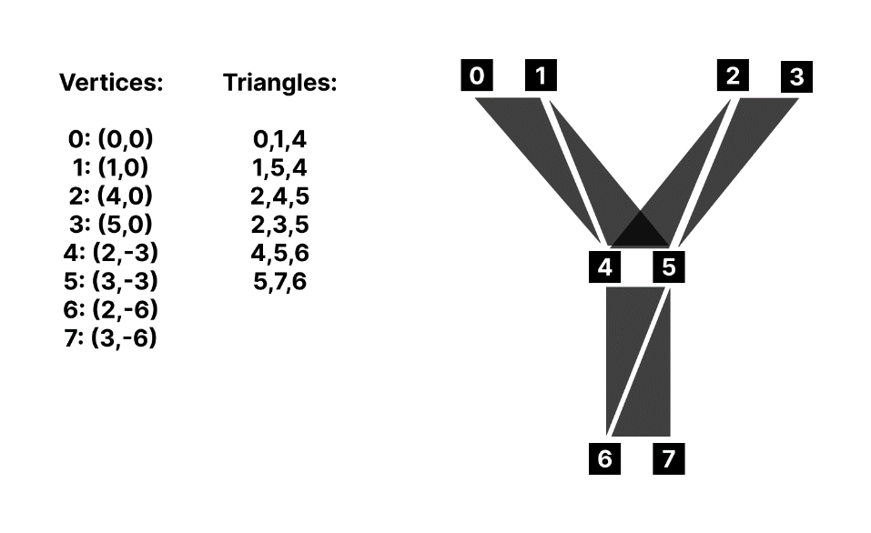</a></td>
    <td><a href="docs/images/object-z.png">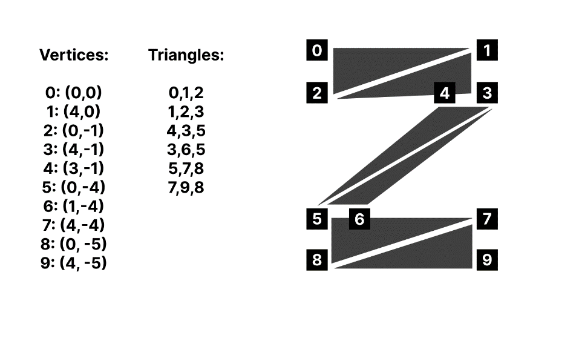</a></td>
  </tr>
  <tr>
    <th>Grid</th>
    <th>Grid border</th>
    <th>Grid zoom behaviour visualised</th>
  </tr>
  <tr>
    <td><a href="docs/images/object-grid.png">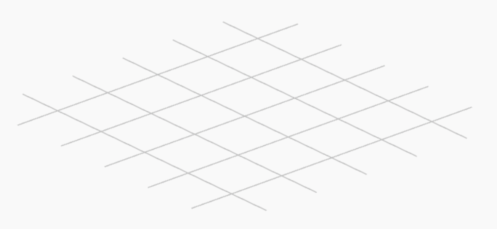</a></td>
    <td><a href="docs/images/object-grid-border.png">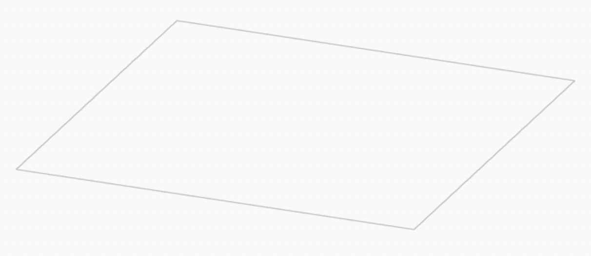</a></td>
    <td><a href="docs/images/object-grid-behaviour.png">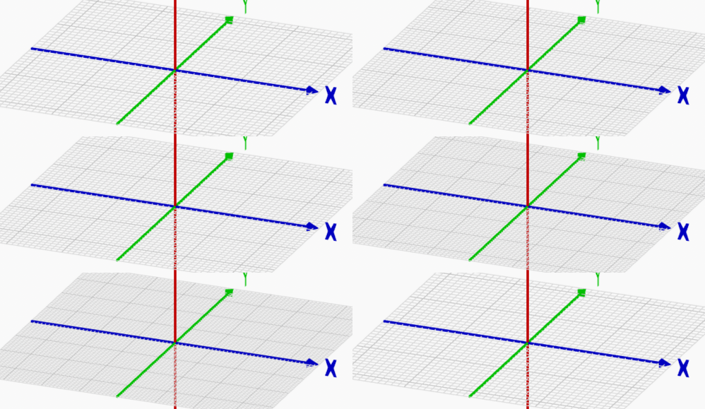</a></td>
  </tr>
</table>
</details>

<details>
<summary>Visual explanation of getting the vertices of a plane (used for lines and planes)</summary>

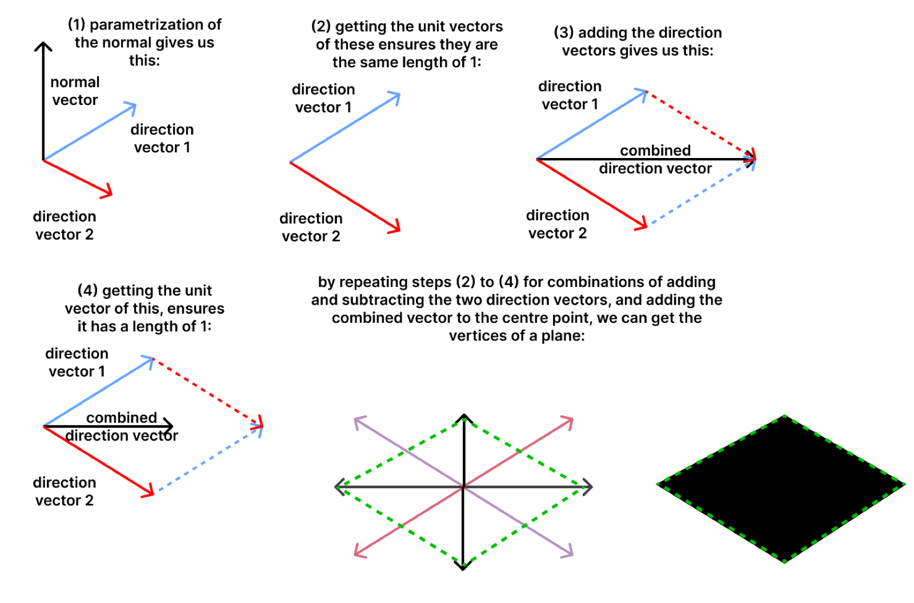
</details>

## Testing

The test plan, expected results and worked answers are in the [write-up](docs/NEA-writeup.pdf). This video steps through each test (timestamps for every test ID are in the write-up):

[](https://www.youtube.com/watch?v=rFsSXs4r9v8)

## Security notes

- All SQL uses prepared statements
- Passwords are hashed with bcrypt (with an additional per-user salt)
- "Remember me" tokens are random, stored hashed, expire after 12 hours, and are sent as `HttpOnly`, `SameSite=Lax` cookies
- Environment APIs check the logged-in user owns the environment
- User-supplied text is escaped on output
- Login attempts are throttled per account

## Known limitations

- No CSRF tokens on forms (partly mitigated by `SameSite=Lax` cookies); logout is a GET link
- CSS is duplicated across pages rather than shared
- `create_user.sql` creates the app user with an empty password, which is fine locally but should be changed for any real deployment

## Acknowledgements

Thanks to the resources I used to teach myself the tools behind this project:

- **WebGL:** [WebGL Fundamentals](https://www.webglfundamentals.org), [MDN WebGL API](https://developer.mozilla.org/en-US/docs/Web/API/WebGL_API) and [this YouTube playlist](https://www.youtube.com/playlist?list=PLjcVFFANLS5zH_PeKC6I8p0Pt1hzph_rt)
- **PHP & MySQL:** W3Schools on [prepared statements](https://www.w3schools.com/php/php_mysql_prepared_statements.asp), [sessions](https://www.w3schools.com/php/php_sessions.asp), [cookies](https://www.w3schools.com/php/php_cookies.asp), [forms](https://www.w3schools.com/php/php_forms.asp) and [regex](https://www.w3schools.com/php/php_regex.asp); [Tutorial Republic on regex](https://www.tutorialrepublic.com/php-tutorial/php-regular-expressions.php); [GeeksforGeeks on receiving JSON POSTs](https://www.geeksforgeeks.org/how-to-receive-json-post-with-php/)
- **JavaScript:** [MDN on sending JSON with the Fetch API](https://developer.mozilla.org/en-US/docs/Web/API/Fetch_API/Using_Fetch#uploading_json_data)

The write-up also includes a screenshot from the Pearson Edexcel A Level Further Mathematics Core Pure Mathematics Book 1 textbook.

## Licence

decimal.js is © Michael Mclaughlin, MIT licence (see `lib/decimal.js-LICENCE.md`).
